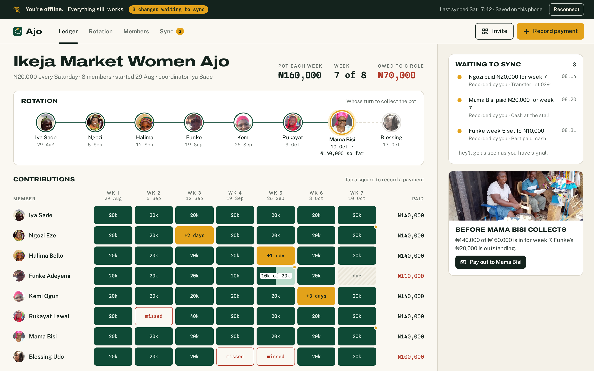
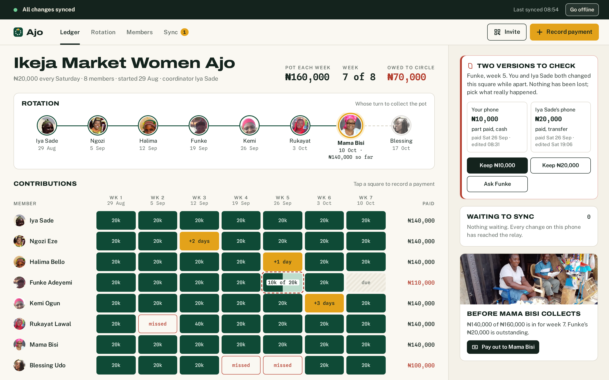
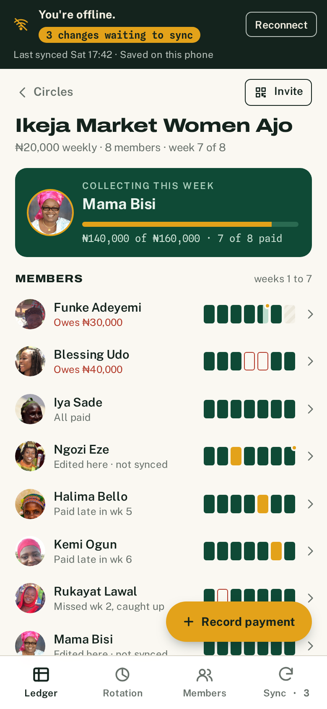
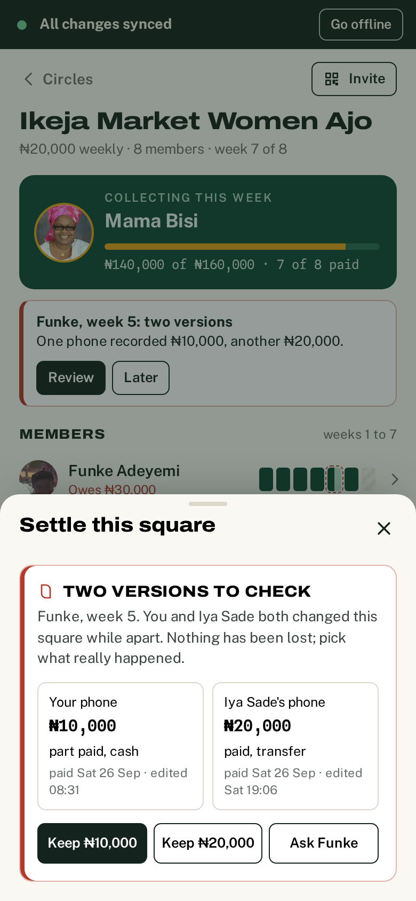
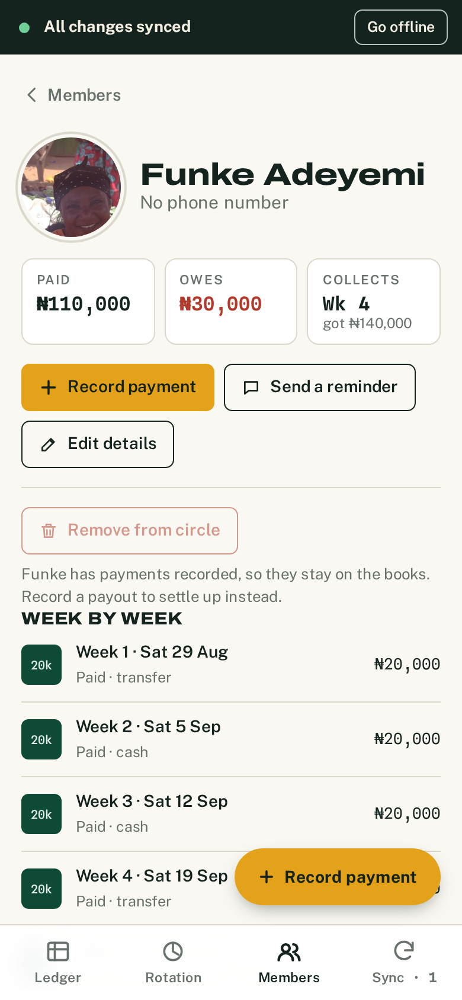

# Ajo

An offline-first ledger for ajo and esusu savings circles. Each member pays the same amount every week or month, one member collects the whole pot each round, and whoever keeps the book needs to know who has paid, who is short and whose turn it is. Usually all of that lives in an exercise book or a WhatsApp group. Ajo puts it in an installable web app that keeps working at the market with no signal, and that copes when two phones edit the same square while they're out of touch.

**Live demo:** [ajo-beige.vercel.app](https://ajo-beige.vercel.app)

<p align="center"></p>

| Desktop, offline                                                               | Desktop, after syncing                                                                          |
| ------------------------------------------------------------------------------ | ----------------------------------------------------------------------------------------------- |
|  |  |

| Phone ledger                                               | Settling a clash                                              | Member history                                         |
| ---------------------------------------------------------- | ------------------------------------------------------------- | ------------------------------------------------------ |
|  |  |  |

## Try the demo

The app opens as **Kemi's phone**, offline, with three payments recorded since she last had signal.

1. Record a payment: tap any square on desktop, or **Record payment** on a phone.
2. Press **Reconnect** in the dark strip at the top. The queue drains, and Iya Sade's version of Funke's week 5 (sent from her phone last night) turns up next to Kemi's. Neither is thrown away; pick one, or send Funke a message to ask.
3. On the **Sync** tab, **Open Iya Sade's phone** starts a second "phone" in a new tab with its own storage. Turn the signal off on both, edit the same square differently, turn it back on, and watch the clash appear on both.
4. **Reset demo data** on the Sync tab puts everything back.

## Features

- **Contribution grid** with paid, paid late (+N days), part paid, missed and due states, a "not synced yet" marker and a dashed outline for clashing squares. On phones it becomes one strip per member, with whoever owes money sorted to the top.
- **Recording payments** with amount shortcuts, typed amounts like `20k` or `₦20,000`, cash/transfer/POS, reference, date paid and a live preview of how the square will read. Every save can be undone from the toast.
- **Rotation**: whose turn it is, what's in the pot, who is still short, and a payout flow that asks before paying out less than the full pot. Turns that have been paid out are locked when you reorder.
- **Members**: photos (resized on the device before they sync), phone numbers, a week-by-week history, reminders through the share sheet, and removing someone only while they have nothing on the books.
- **Starting and joining circles**: a three-step setup with "draw lots" for the order, plus an invite QR code, link and code. Joining needs signal once; after that everything works offline.
- **Offline-first sync** with a visible queue of what hasn't left the phone yet, and a conflict card when two phones disagree.
- **Installable PWA**: manifest, maskable icons, and a service worker that precaches the app, the Automerge wasm, fonts and photos, with a prompt when a new version is ready.
- Naira formatting throughout, with dates written the way people say them ("Sat 10 Oct").

## How it works

```
 Kemi's tab                         Iya Sade's tab
 ┌────────────────────┐             ┌────────────────────┐
 │ React UI           │             │ React UI           │
 │ Engine             │             │ Engine             │
 │  Automerge doc     │             │  Automerge doc     │
 │  IndexedDB         │             │  IndexedDB         │
 │  ajo-device-kemi   │             │  ajo-device-iya-…  │
 └─────────┬──────────┘             └─────────┬──────────┘
           │   merge on push/pull             │
           └──────────►  ajo-relay  ◄─────────┘
                      (IndexedDB)
           BroadcastChannel "ajo": "relay updated, come and pull"
```

- **Each circle is one Automerge document** (`src/domain/types.ts`). Payments are keyed `memberId:round`, so two phones writing the same square write the same key.
- **Every phone has its own IndexedDB database**, chosen by `?device=` and remembered for the tab. Writes are merge-on-write inside a single transaction (`src/sync/storage.ts`), so two tabs of the same phone can't clobber each other.
- **There is no server.** A separate IndexedDB database plays the relay, and BroadcastChannel stands in for a push notification. Swapping it for a real WebSocket relay (for example `automerge-repo` with a sync server) would only touch `src/sync/engine.ts`.
- **The sync queue is real**, not a counter. Each local edit records the hash of the Automerge change it made. An item leaves the queue when the relay's copy contains that hash.
- **Conflicts come from Automerge itself.** Automerge never drops a concurrent write; it picks a deterministic winner and keeps the others available through `getConflicts`. Ajo reads those (`src/crdt/conflicts.ts`) and shows both versions. Choosing one writes it again, which is causally newer than both, so the conflict clears on every phone once they sync.

## Design decisions and trade-offs

- **Visual identity.** Ledger green, receipt-paper background, mustard for "pending" and brick red for money owed. The display face is Archivo at its widest, with Spline Sans Mono for amounts so columns of naira line up. No gradients and no icon fonts; the icons are a small hand-drawn SVG set.
- **Why a CRDT and not last-write-wins on a timestamp.** Phone clocks at the market are often wrong, and a ledger that silently keeps the later timestamp can lose ₦10,000 without anyone noticing. Automerge gives a deterministic merge everywhere and still lets the UI ask a human when it matters.
- **Totals are by money, squares are by history.** If Rukayat missed week 2 and paid ₦40,000 in week 3, week 2 stays "missed" (that's what happened) but she owes nothing.
- **Rotation order uses list operations.** Moving someone is a splice, not a whole-array replace, so a member added on another phone at the same time isn't lost. Reads go through `normaliseOrder` to drop duplicates from two concurrent moves.
- **Photos are tiny on purpose.** They live inside the synced document, so they're cropped to 192 px JPEGs (around 10 KB) on the device.
- **Bundle size.** Automerge's wasm is about 3.6 MB (1.2 MB gzipped). The slim build loads it as a separate file the service worker precaches, rather than inlining it as base64 into the JS. On a slow first visit that's the main cost; after that the app starts from cache.
- **The "Signal" switch** is a demo control that sits on top of the browser's real online/offline state, so the offline story can be shown without unplugging anything.
- **Known limits.** The relay only exists inside one browser, so invite links work between tabs, not between two real phones. There are no accounts, so anyone with a link can join, and nothing is encrypted at rest.

## Accessibility

- The grid is a real table with row and column headers, and each square is a button whose name reads the whole situation: "Funke Adeyemi, week 5, Sat 26 Sep, part paid ₦10,000, two versions to check, not synced yet".
- Sheets use the native `<dialog>` element, so focus is trapped, Escape closes them and focus returns to the button that opened them.
- Visible focus rings everywhere, a skip link, `aria-current` on navigation, live regions for sync status and toasts, and error messages tied to their fields.
- Colour is never the only signal: late squares print "+2 days", missed squares print "missed", and there's a key under the grid.
- Animations are short and turned off under `prefers-reduced-motion`.
- Every screen is checked with axe (WCAG 2.2 AA rules) in the end-to-end tests, at phone and desktop sizes.

## Stack

React 19, TypeScript, Vite, React Router, Automerge 3, `idb`, `vite-plugin-pwa` (Workbox), `qrcode`. Tests use Vitest with `fake-indexeddb`, and Playwright with `@axe-core/playwright`. Fonts are self-hosted through Fontsource so they work offline.

## Running it

```bash
npm install
npm run dev          # http://localhost:5173
npm test             # unit tests (domain logic, CRDT merges, storage, sync engine)
npm run e2e          # builds, serves, and runs Playwright at 390px and 1440px
npm run lint && npm run typecheck
```

The service worker only runs in a production build: `npm run build && npm run preview`.

`npx tsx scripts/capture.ts` regenerates the screenshots and GIF in `docs/` from a running preview (needs ffmpeg).

## Deploying to Vercel

The repo includes `vercel.json` with the SPA rewrite and cache headers for the service worker.

```bash
npm i -g vercel
vercel        # first deploy; accept the detected Vite settings
vercel --prod
```

Or import the GitHub repo in the Vercel dashboard; the build command is `npm run build` and the output directory is `dist`.

## Project layout

```
src/
  domain/   money, dates, ledger maths, rotation (pure functions, unit tested)
  crdt/     Automerge document edits, conflict detection, the demo seed
  sync/     IndexedDB storage and the sync engine
  circle/   ledger, rotation, members and sync screens, plus the sheets
  pages/    home, new circle, join, credits
  ui/       icons, avatar, dialog sheet, toasts
e2e/        Playwright specs
```

## Photo credits

The people in the demo circle are made up; their photos are real, freely licensed images from Wikimedia Commons used under CC BY-SA 4.0. Photographers: Jibofoto (Nathaniel Ajibola), Kambai Akau, Jamie Tubers, Dotun55, Bamigbade Olugbenga, Ngostary2k, Zilzy and Iambeliever. Full details with source links are in [CREDITS.md](CREDITS.md) and on the in-app credits page.

## Licence

Code is MIT, see [LICENSE](LICENSE). Photos keep their own licences, listed in [CREDITS.md](CREDITS.md).
